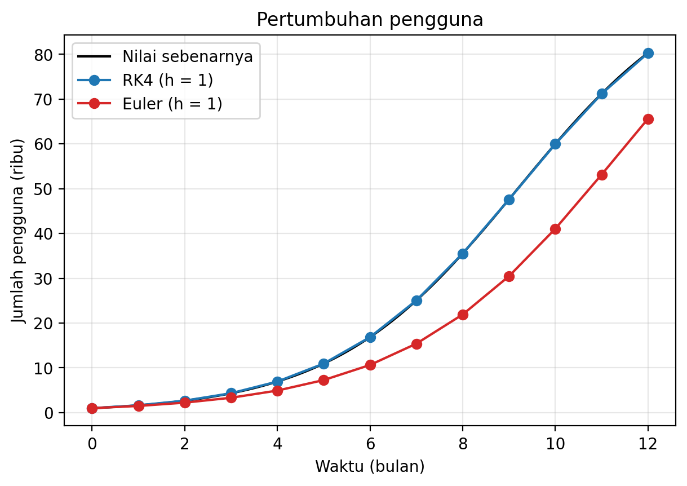
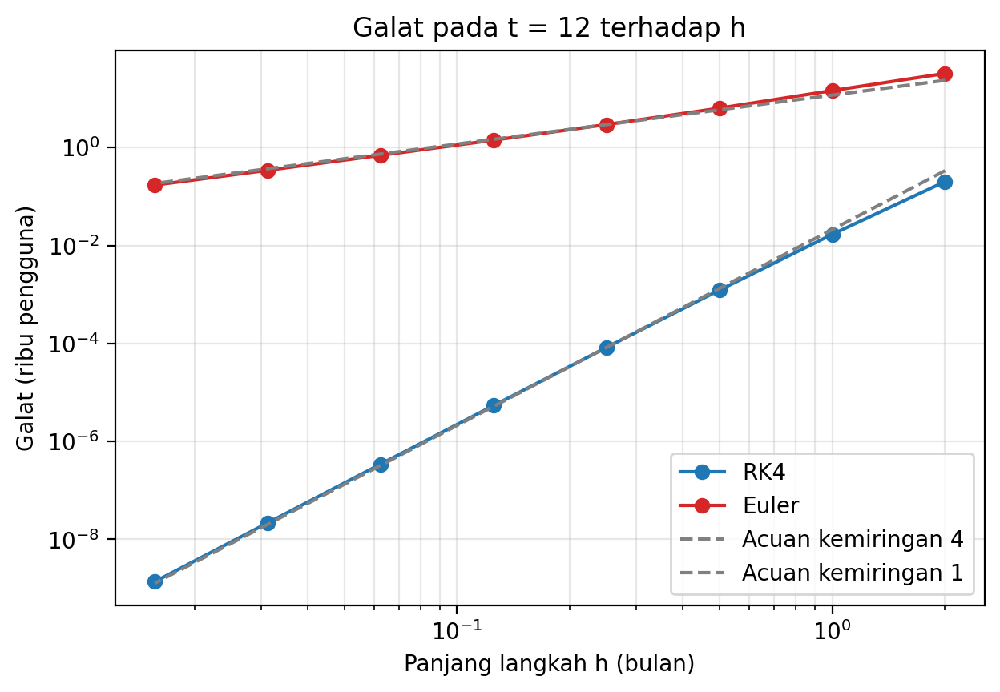
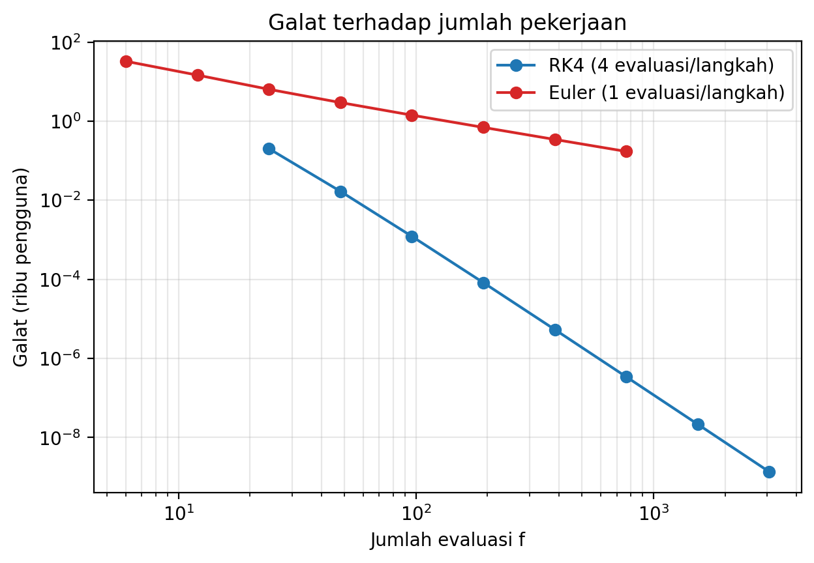
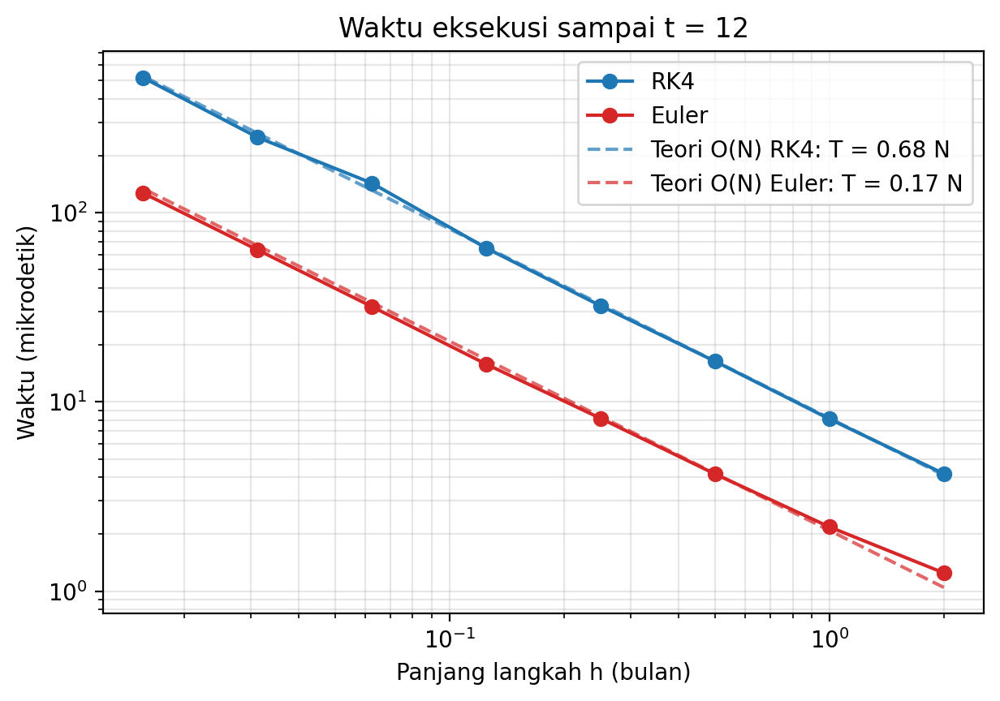

# Perbandingan RK4 dan Euler pada Model Pertumbuhan Pengguna Aplikasi

Program Python untuk membandingkan metode Euler dan Runge-Kutta orde 4 (RK4) dalam memperkirakan pertumbuhan pengguna aplikasi. Perbandingan dilakukan dengan melihat hasil perhitungan, galat, jumlah evaluasi fungsi, dan waktu eksekusi.

Repositori ini merupakan pendamping laporan *Analisis Algoritma Runge-Kutta Orde 4 pada Prediksi Pertumbuhan Pengguna Aplikasi*.

## Apa yang dihitung

Model yang digunakan adalah pertumbuhan logistik. Pengguna bertambah semakin cepat, lalu pertumbuhannya melambat ketika mendekati batas maksimum.

```text
dU/dt = r * U * (1 - U / K)
```

| Simbol | Arti | Nilai |
|---|---|---|
| U | Jumlah pengguna (dalam ribu) | 1 (1.000 pengguna) |
| r | Laju pertumbuhan | 0,5 per bulan |
| K | Batas maksimum pengguna | 100 (100.000 pengguna) |
| T | Waktu akhir | 12 bulan |
| h | Panjang langkah waktu | 2; 1; 0,5; ...; 0,015625 |

Model ini memiliki solusi eksak yang digunakan sebagai pembanding untuk menghitung galat, yaitu selisih antara hasil perhitungan dan nilai sebenarnya.

## Isi repositori

| File | Fungsi |
|---|---|
| `rk4_euler.py` | Perhitungan Euler dan RK4, simulasi, solusi eksak, dan pengujian hasil. |
| `grafik.py` | Membuat empat grafik dan mengukur waktu eksekusi. |
| `grafik_pertumbuhan.png` | Grafik pertumbuhan pengguna sampai bulan ke-12. |
| `grafik_galat.png` | Grafik galat terhadap panjang langkah. |
| `grafik_biaya.png` | Grafik galat terhadap jumlah evaluasi fungsi. |
| `grafik_waktu.png` | Grafik waktu eksekusi kedua metode. |

## Cara menjalankan

Program dikembangkan menggunakan Python 3.13. Perhitungan utama tidak membutuhkan library tambahan. `matplotlib` hanya diperlukan untuk membuat grafik.

```bash
python rk4_euler.py
```

Untuk membuat grafik, jalankan:

```bash
pip install matplotlib
python grafik.py
```

Program pertama menampilkan hasil kasus uji, tabel galat pada t = 12, dan perbandingan jumlah evaluasi fungsi untuk ketelitian yang sama. Program kedua membuat empat gambar PNG dan menampilkan tabel waktu eksekusi.

## Hasil utama

- Ketika h dibagi dua, galat RK4 mengecil mendekati 16 kali, sedangkan galat Euler mendekati 2 kali. Hasil ini sesuai dengan teori bahwa RK4 berorde 4 dan Euler berorde 1.
- Pada h = 1 bulan, galat RK4 sekitar 17 pengguna, sedangkan galat Euler sekitar 14.700 pengguna.
- Satu langkah RK4 memanggil fungsi `f` empat kali, sedangkan Euler satu kali. Namun, pada pengujian ketelitian yang sama di t = 2, Euler membutuhkan sekitar 35 sampai 189 kali lebih banyak evaluasi fungsi.
- Waktu eksekusi RK4 pada pengujian berada di kisaran 3,51–3,99 kali waktu Euler untuk panjang langkah yang sama.

## Grafik









## Catatan

- Waktu eksekusi dapat berbeda tergantung komputer dan kondisi saat program dijalankan. Karena itu, yang dibandingkan adalah hasil pengukuran kedua metode.
- Jumlah pengguna dan batas maksimum hanya contoh untuk simulasi, bukan data aplikasi sebenarnya.
- Pengujian masih menggunakan satu model dan satu waktu akhir, yaitu 12 bulan.
